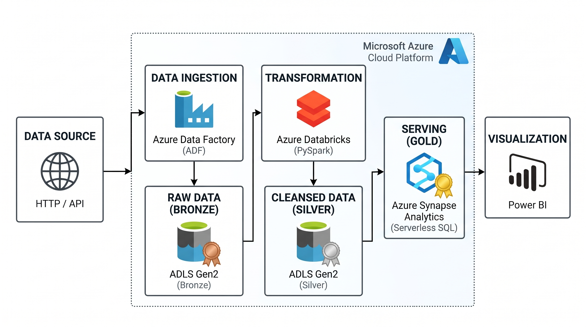
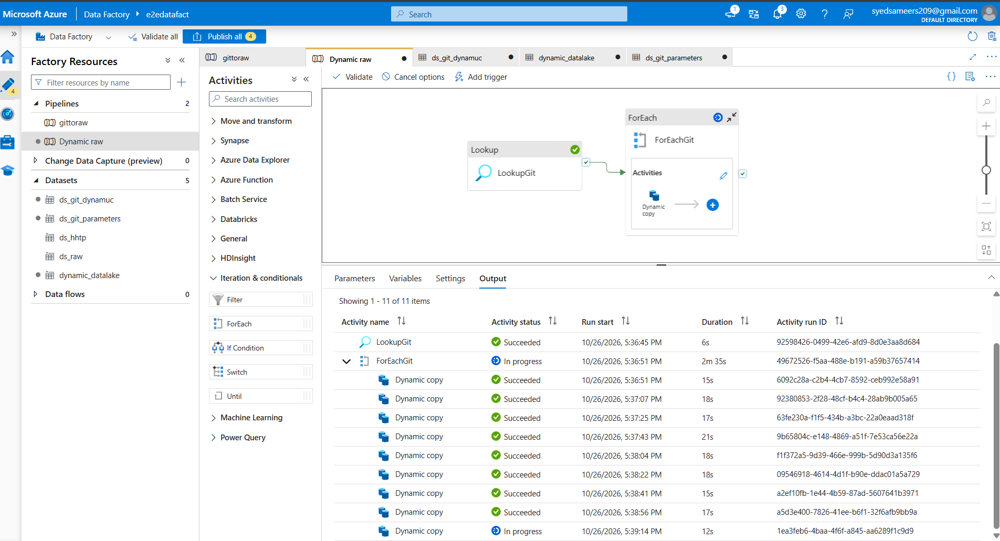
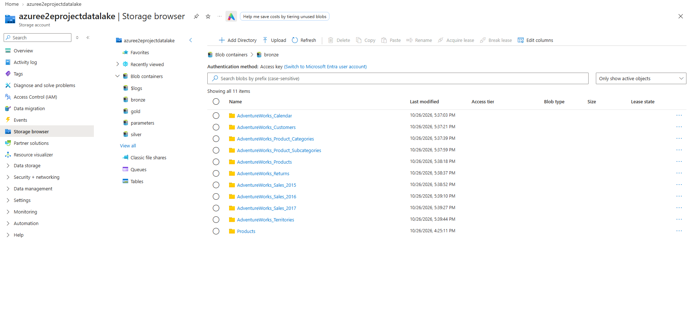
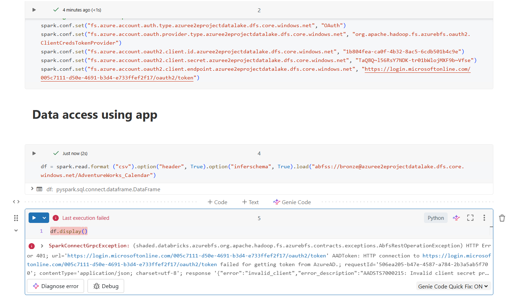
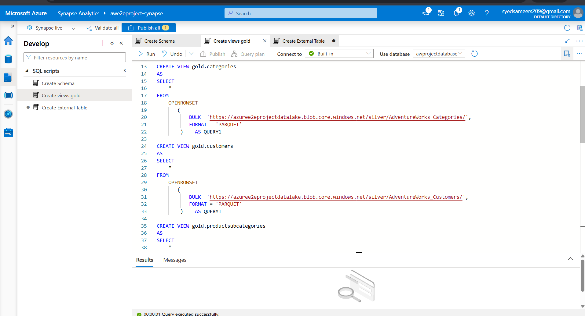
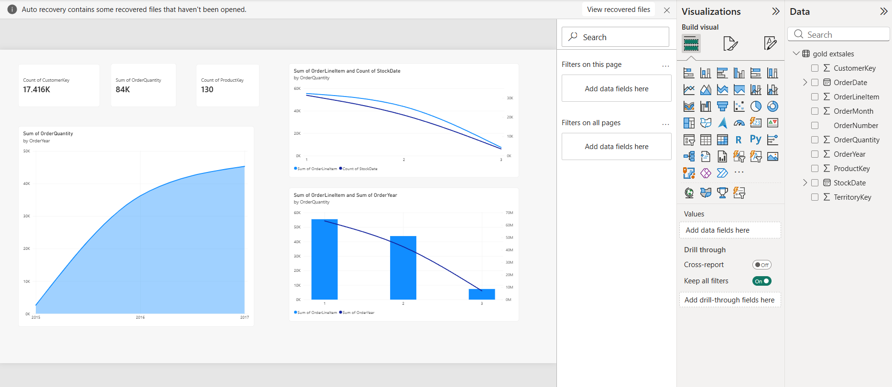

# 🏢 Azure End-to-End Enterprise Data Engineering Project (AdventureWorks)

An enterprise-grade, cloud-native data engineering solution built on Microsoft Azure[cite: 24]. This project implements a fully automated **Medallion Architecture (Bronze ➔ Silver ➔ Gold)** to ingest retail sales data dynamically, clean and standardize transactional records at scale using PySpark, model logical views and external tables in Azure Synapse Serverless SQL, and deliver self-service analytics to Power BI[cite: 23, 24].

---

## 🏛️ Architecture & Data Flow

Below is the complete architectural layout of the pipeline, showcasing the dynamic transition of data through ingestion, transformation, serving, and visualization layers[cite: 23, 24]:

  

1. **Ingest (Bronze)**: Metadata-driven dynamic ingestion with Azure Data Factory into ADLS Gen2[cite: 24].
2. **Transform (Silver)**: PySpark batch transformation and standardization inside Azure Databricks[cite: 24].
3. **Serve (Gold)**: Abstracted serverless views and optimized CETAS table materialization with Azure Synapse Analytics[cite: 24].
4. **Consume (Reporting)**: KPI dashboard delivery via Direct Synapse SQL endpoint connector in Power BI[cite: 24].

---

## ⚙️ Layer-by-Layer Implementation & Screenshots

### 1️⃣ Data Ingestion & Storage (ADF & ADLS Gen2 Bronze)
- **Pipeline Configuration**: Leveraged a metadata-driven dynamic framework to replace static copy tasks. By ingesting a control parameters file, the ADF `ForEach` container dynamically loops through 11 operational targets to run parameterized copies[cite: 25].

  

- **Data Storage**: Data lands in its raw, unaltered state in ADLS Gen2 `bronze` container organized dynamically by entities.

  

#### Ingested Entities (GitHub Data Source API)
* `AdventureWorks_Calendar`
* `AdventureWorks_Customers`
* `AdventureWorks_Product_Categories`
* `AdventureWorks_Product_Subcategories`
* `AdventureWorks_Products`
* `AdventureWorks_Returns`
* `AdventureWorks_Sales_2015 / 2016 / 2017`
* `AdventureWorks_Territories`

---

### 2️⃣ PySpark Transformation (Azure Databricks Silver)
- Authenticated securely to ADLS Gen2 utilizing OAuth 2.0 through Microsoft Entra ID App registrations, keeping credentials safe via Azure Key Vault secrets[cite: 19].
- Applied large-scale transform operations: Unified multiple years of transactional partition files (`Sales 2015`, `2016`, `2017`), parsed irregular date formats (`MM-dd-yyyy` and `M/d/yyyy`), cast strict schema typing, handled nulls, split string IDs (`split`), and deleted composite duplicates.
- Persisted datasets as partitioned Parquet files inside the `silver` storage zone[cite: 22].
- 📄 **Source Code**: [View Complete PySpark Script (`databricks_silver_transformations.py`)](databricks_silver_transformations.py)

  

---

### 3️⃣ Serving Layer & Logical Data Warehouse (Azure Synapse Analytics Gold)
- Configured Azure Synapse workspace with a System-Assigned Managed Identity and granted it `Storage Blob Data Contributor` on ADLS Gen2[cite: 22].
- **Serverless Abstraction Layer (`OPENROWSET`)**: Created serverless logical views over cleansed Silver Parquet files directly within the data lake, enabling ad-hoc SQL querying without duplicate storage costs[cite: 22].
- **Optimized Materialization (CETAS)**: Implemented `CREATE EXTERNAL TABLE AS SELECT` with Snappy Parquet compression to write optimized Gold reporting tables into the `gold` container.
- 📄 **Source Code**: [View Complete SQL Script (`synapse_gold_layer.sql`)](synapse_gold_layer.sql)

  

---

### 4️⃣ Business Intelligence & Visual Analytics (Microsoft Power BI)
- **Direct Connectivity**: Connected Power BI Desktop to Azure Synapse using the native Azure Synapse Analytics SQL connector via the serverless SQL Endpoint (`ondemand.sql.azuresynapse.net`).
- **Semantic Modeling**: Structured dimensional models linking materialized `gold.ext_sales` fact records with dimension views (`customers`, `products`, `calendar`, `territories`).
- **Visual Analytics**: Tracked customer reach, order volume progression (2015–2017), product sales distributions, and transaction thresholds.

  

